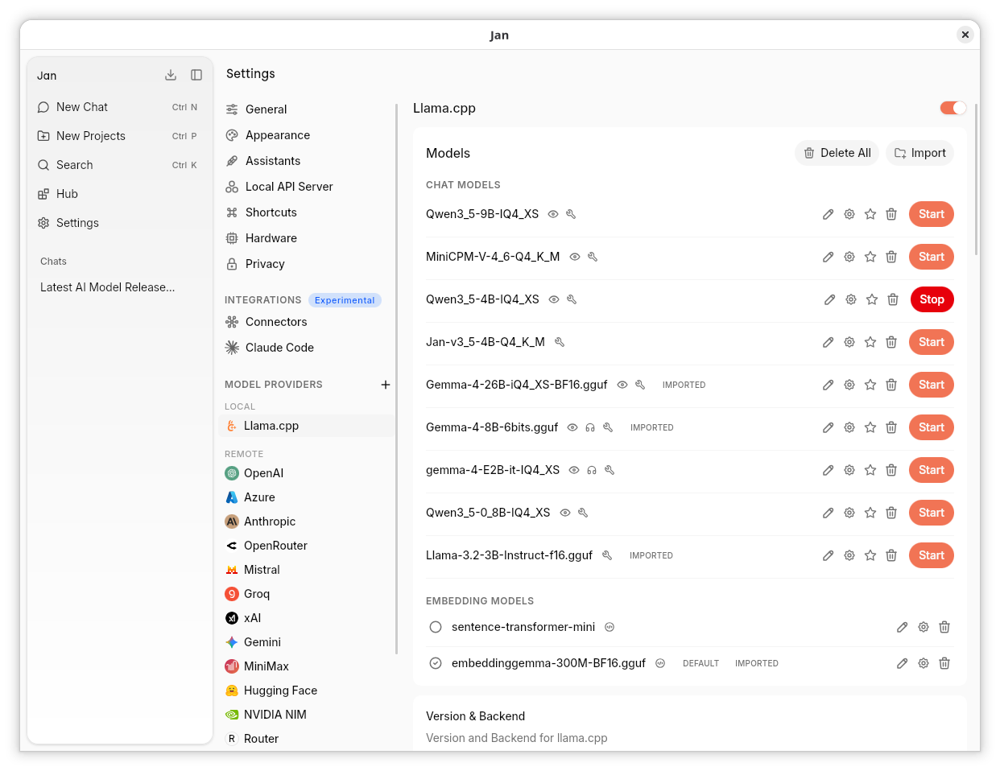
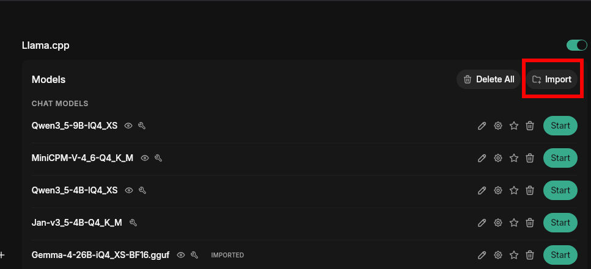

import { Tabs } from 'nextra/components'
import { Callout, Steps } from 'nextra/components'
import { Settings, EllipsisVertical, Plus, FolderOpen, Pencil } from 'lucide-react'

# Local AI Engine (llama.cpp)

## What is llama.cpp?

llama.cpp is the engine that runs AI models locally on your computer. Think of it as the software that takes an AI model file and makes it actually work on your hardware - whether that's your CPU, graphics card, or Apple's M-series chips.

Originally created by Georgi Gerganov and now maintained by the [ggml-org/llama.cpp](https://github.com/ggml-org/llama.cpp) community, llama.cpp is designed to run large language models efficiently on consumer hardware without requiring specialized AI accelerators or cloud connections.

## Why This Matters

**Privacy**: Your conversations never leave your computer
**Cost**: No monthly subscription fees or API costs
**Speed**: No internet required once models are downloaded
**Control**: Choose exactly which models to run and how they behave

## Engine version

The llama.cpp engine is built into Jan and updates together with the app, so there is no separate backend to download or pick. **Settings** > **Llama.cpp** shows the version, build and commit; quote them when you report a model that fails to load. To run a model on a different llama.cpp version, run your own `llama-server` and connect it as a [custom endpoint](/docs/desktop/remote-models/custom-endpoint#use-a-different-llamacpp-version).

## Accessing Engine Settings

Find llama.cpp settings at **Settings** (<Settings width={16} height={16} style={{display:"inline"}}/>) > **Llama.cpp** under Model Providers:

## Model Management

The **Models** section at the top of the Llama.cpp settings page lets you manage all your local GGUF models.

### Download from Hub

Browse and download models directly from the [Hub](/docs/desktop/manage-models) tab in the left sidebar. Downloaded models will appear here automatically.

### Import Local Files

Click **Import** to link a GGUF model file already on your computer. This is useful for models downloaded via your browser from Hugging Face, or models shared with other apps — Jan links to the file in place without copying it.

### Delete a Model

Click the trash icon next to any model to remove it. This deletes the model file from Jan's data folder (linked files leave the original intact).

<Callout type="info">
These are advanced settings. You typically only need to adjust them if models aren't working properly or you want to optimize performance for your specific hardware.
</Callout>

## Engine Management

| Setting | What It Does | Default | When You Need It |
|---------|-------------|---------|------------------|
| **Engine version** | Shows the bundled llama.cpp version, build and commit | - | Quote it when you report a model that fails to load |
| **Max Concurrently Loaded Models** | Maximum models the engine keeps loaded at once; the least recently used idle model is unloaded first | 1 | Raise it to keep several models warm; 0 means unlimited |
| **Timeout for llamacpp** | Connection and load timeout, in seconds | 600 | Raise it for very large models on slow disks |
| **Environmental variables** | Extra `KEY=VALUE` variables for the engine, separated by `;` | Empty | Only when a llama.cpp guide asks for a specific variable |

<Callout type="info">
Since v0.8.5, llama.cpp is compiled into Jan and runs in a supervised worker process (`jan-llama-worker`). There is no `llama-server` to download and no backend to install or update: the engine updates together with the app. The worker loads and unloads models on demand, so you never start or stop a model by hand. If the worker stops unexpectedly, sending the message again starts it again.
</Callout>

## Hardware Support

Each Jan installer ships the GPU backends for its platform, and the engine picks the CPU code path that suits your processor when it starts. There is no build to choose.

| Platform | GPU acceleration included |
|----------|---------------------------|
| **Windows (x64)** | NVIDIA through CUDA 13; AMD, Intel Arc and NVIDIA through Vulkan |
| **Windows (ARM64)** | NVIDIA through CUDA 13, with Vulkan as a fallback |
| **Linux (x64)** | NVIDIA through CUDA 13; AMD, Intel Arc and NVIDIA through Vulkan |
| **macOS (Apple Silicon)** | Metal, used automatically |

Everything runs on the CPU when no supported GPU is available.

<Callout type="warning">
Intel-based Macs are not supported: the bundled engine is built for Apple Silicon only. On an Intel Mac, Jan still works with remote and custom providers, but local models do not run.
</Callout>

### Choosing which GPU llama.cpp uses

Go to **Settings** (<Settings width={16} height={16} style={{display:"inline"}}/>) > **Hardware** > **GPUs**:

- Turn a GPU's switch off to keep the engine off it, or on to use it.
- When a GPU is reachable through more than one API (for example an NVIDIA card through both CUDA and Vulkan), click the API you want under its name. CUDA is usually faster on NVIDIA cards.
- If you add or wake a GPU while Jan is running, press **Refresh** so the engine restarts and picks it up.

Changing these stops the loaded models; they reload on next use.

### Using a different llama.cpp version or backend

The bundled engine cannot be swapped. To run a llama.cpp version or backend that Jan does not ship (for example HIP/ROCm on Windows), run your own `llama-server` and connect it as a [custom endpoint](/docs/desktop/remote-models/custom-endpoint#use-a-different-llamacpp-version).

## Performance Settings (Engine-wide)

These engine-wide settings apply to every model the engine loads. Per-model overrides (Context Size, GPU Layers, Batch Size, Disable KV Offload, etc.) live on the model's own settings page.

| Setting | What It Does | Default | Impact |
|---------|-------------|---------|---------|
| **Continuous Batching** | Process multiple requests at once | Enabled | Matches llama.cpp; leave on unless you are debugging |
| **Parallel Sequences** | Number of parallel sequences to decode | 0 (llama.cpp default) | Raise for concurrent serving |
| **Threads** | Number of threads to use during generation | -1 (auto) | -1 uses all logical cores |
| **Threads (Batch)** | Threads for batch and prompt processing | -1 (same as Threads) | Tune separately for prompt-heavy workloads |
| **Batch Size** | Logical maximum batch size for processing prompts | 2048 | Lower it if prompt processing runs out of memory |
| **uBatch Size** | Physical maximum batch size | 512 | Controls memory usage during batching |
| **Fit (auto-adjust to device memory)** | Adjust unset settings so the model fits in device memory | Disabled | Enable to let llama.cpp choose GPU layers and context for you |
| **Fit Target per Device (MiB)** | Target memory margin per device for Fit, as a comma-separated list of MiB values; a single value applies to every device | 1024 | Only used when Fit is enabled |
| **Fit Minimum Context Size** | Smallest context size, in tokens, that Fit may set | 4096 | Only used when Fit is enabled |
| **Devices for Offload** | Comma-separated accelerators, named as in the detected hardware list | Empty (all) | Restrict which GPUs the model can use; `none` disables offload |
| **GPU Split Mode** | How to distribute the model across GPUs (None, Layer, Row, Tensor) | Layer | Layer is the common multi-GPU choice |
| **Main GPU Index** | The GPU used for the model (split mode None) or intermediate results (split mode Row) | 0 | Change to target a specific GPU |
| **Tensor Split** | Proportions for splitting the model across devices, e.g. `3,1` | Empty (even split) | Uneven GPUs |
| **Disable Op Offload** | Keep host tensor operations on the CPU instead of offloading them to the accelerator (`--no-op-offload`) | Disabled | Advanced tuning only |
| **MoE Layers on CPU** | Keep the Mixture-of-Experts weights of the first N layers in CPU memory | 0 | Fit a large MoE model in limited VRAM |
| **Dense FFN Layers on CPU** | Keep the dense feed-forward weights of the first N layers in CPU memory | 0 | The same for dense models |

## Memory Settings (Engine-wide)

These engine-wide settings control how every loaded model uses system and GPU memory.

| Setting | What It Does | Default | When to Change |
|---------|-------------|---------|----------------|
| **Flash Attention** | Enable Flash Attention kernel | Auto | Force On or Off only if you hit kernel issues |
| **Disable mmap** | Don't memory-map model files | Disabled | Enable if experiencing crashes or pageouts |
| **Lazy Tensor Reading** | Read the rows of large arch-marked tensors (e.g. per-layer embeddings) from disk on demand instead of keeping them in memory; Auto applies it above 4 GiB | Auto | Off keeps those tensors in memory; requires mmap, so it has no effect with Disable mmap on |
| **MLock** | Keep model in RAM, prevent swapping | Disabled | Enable if you have enough RAM and want consistent performance |
| **Context Shift** | Allow trimming the start of the prompt when context fills | Disabled | Enable for very long chats or multiple tool calls |
| **Disable KV Cache Offload** | Keep the KV cache in system RAM instead of GPU memory | Disabled | When VRAM is scarce, at the cost of speed |
| **Unified KV Cache** | Use a single KV buffer shared across all slots | Auto | Saves memory when running multiple parallel slots |
| **Context Per Slot** | Cap, in tokens, on how much of the unified KV cache one slot may use; 0 lets a slot fill the whole cache | 0 | Only applies when the KV cache is unified |
| **KV Cache K Type** | KV-cache precision for keys | f16 | Switch to q8_0 / q4_0 to save VRAM |
| **KV Cache V Type** | KV-cache precision for values | f16 | Switch to q8_0 / q4_0 to save VRAM |

<Callout type="info">
**Per-model settings** (configured on each model's page, not here): Context Size, GPU Layers, Batch Size, **Disable KV Offload** (enable to keep the KV cache on CPU when GPU VRAM is tight), Override Tensor Buffer Type, Custom Jinja Chat template, Chat template options (`chat_template_kwargs`), and sampling parameters. Jan writes the engine-wide settings as the `[*]` defaults in `router.preset.ini` in its data folder, and each model's own settings override them.
</Callout>

### KV Cache Types Explained
- **f16**: Full 16-bit precision, uses more memory but highest quality
- **q8_0**: 8-bit quantized, balanced memory usage and quality
- **q4_0**: 4-bit quantized, uses least memory, slight quality loss

## Advanced Settings

These settings are for fine-tuning model behavior and advanced use cases.

<Callout type="info">
**Custom Jinja Chat template**, **Chat template options**, **Mirostat Sampling**, and the **Output Constraints** (Grammar / JSON Schema) below are **per-model** settings, configured on an individual model's page (the gear icon next to the model), not on the engine-wide Settings -> Llama.cpp page. **Max Tokens to Predict**, **Preserve Reasoning History**, **RoPE**, and **Cache & Memory Tuning** are engine-wide.
</Callout>

### Text Generation Control

| Setting | What It Does | Default Value | When to Change |
|---------|-------------|---------------|----------------|
| **Max Tokens to Predict** | Maximum tokens to generate | -1 (infinite) | Set a limit to prevent runaway generation |
| **Preserve Reasoning History** | Keep the reasoning of every earlier assistant turn in the prompt, not just the most recent one | Enabled | Only affects models whose chat template supports it; disable to save prompt tokens |
| **Custom Jinja Chat template** (per-model) | Override model's chat format: a built-in template name, an inline Jinja body, or an absolute path to a `.jinja` file | Empty | Only if model needs special formatting |
| **Chat template options** (per-model) | Extra options the model's chat template accepts (sent as `chat_template_kwargs`, e.g. `enable_thinking`) | Empty | To toggle template features like reasoning or tool formatting per model |

### RoPE (Rotary Position Embedding) Settings

| Setting | What It Does | Default Value | When to Change |
|---------|-------------|---------------|----------------|
| **RoPE Scaling Method** | Context extension method (Model default, None, Linear, YaRN) | Model default | For models that support extended context |
| **RoPE Frequency Base** | Base frequency for RoPE | 0 (loaded from model) | Usually loaded from model |
| **RoPE Frequency Scale Factor** | Frequency scaling factor; 1 forces no scaling | 0 (loaded from model) | Advanced tuning only |

### Cache & Memory Tuning

| Setting | What It Does | Default Value | When to Change |
|---------|-------------|---------------|----------------|
| **Prompt Cache RAM (MiB)** | Maximum prompt cache size in MiB (`--cache-ram`). -1 = unlimited, 0 = disabled | 8192 | Lower it to cap RAM used for prompt caching |
| **Remember Conversations Between Sessions** | Keep each conversation's prompt cache on disk so reopening it does not re-read the whole conversation | Enabled | Disable to save disk space |
| **Conversation Cache Disk Limit (MiB)** | Disk budget for saved conversation caches; the oldest are dropped first | 8192 | Raise it if you switch between many long conversations |
| **Cache Reuse** | Min chunk size of matching prefix tokens to reuse from cache (`--cache-reuse`) | 0 (disabled) | Set a positive value to speed up repeated prompts with a shared prefix |
| **Full SWA Cache** | Use full-size SWA cache (`--swa-full`) | Disabled | Enable if a sliding-window model (e.g. Gemma) reprocesses the whole prompt every turn (costs memory) |
| **Context Checkpoints** | Maximum context checkpoints kept per slot, which let a shifted context be restored instead of reprocessed (`--ctx-checkpoints`) | 32 | Advanced tuning only |
| **Checkpoint Minimum Step** | Minimum number of tokens between context checkpoints (`--checkpoint-min-step`) | 8192 | Advanced tuning only |
| **Keep First N Tokens** | Tokens from the initial prompt to keep on context shift (`--keep`, -1 = keep all) | 0 | Increase to preserve more of the system prompt when context fills |

### Mirostat Sampling (per-model)

| Setting | What It Does | Default Value | When to Change |
|---------|-------------|---------------|----------------|
| **Mirostat** | Adaptive perplexity-targeting sampler (Off, v1, v2); overrides Top K / Top P / Min P | Off | Try v1 or v2 for more consistent output |
| **Mirostat Eta** | Mirostat learning rate | 0.1 | Lower for more stable output |
| **Mirostat Tau** | Target entropy; lower is more focused | 5 | Higher for more variety |

### Output Constraints (per-model)

| Setting | What It Does | Default Value | When to Change |
|---------|-------------|---------------|----------------|
| **Grammar** | Constrain output with a GBNF grammar: an inline grammar body or an absolute path to a `.gbnf` file | Empty | For structured output (JSON, code, etc.) |
| **JSON Schema** | Constrain the output to valid JSON matching a schema; ignored if a grammar is also set | Empty | When you need specific JSON formats |

## Troubleshooting Common Issues

**Models won't load:**
- Check if you have enough RAM/VRAM
- Update Jan: the engine updates with the app, and newer model architectures need a newer engine
- Turn the GPU off in **Settings** > **Hardware** to see whether the model loads on the CPU
- If a model only works on a different llama.cpp version, [run your own `llama-server`](/docs/desktop/remote-models/custom-endpoint#use-a-different-llamacpp-version)

**Very slow performance:**
- Make sure your GPU is turned on in **Settings** > **Hardware**
- Increase GPU Layers in model settings
- Close other memory-intensive programs

**Out of memory errors:**
- Reduce Context Size in model settings
- Switch KV Cache Type to q8_0 or q4_0
- Try a smaller model variant

**Random crashes:**
- Update graphics drivers
- On an NVIDIA card, try its Vulkan API instead of CUDA (or the reverse) in **Settings** > **Hardware**
- Disable overclocking if you have it enabled

## Quick Setup Guide

**For most users:**
1. Leave all settings at their defaults; Jan detects your GPU and uses it
2. Keep Jan updated, which also updates the engine
3. Only adjust settings if you experience problems

**If you have an NVIDIA graphics card:**
1. In **Settings** > **Hardware**, make sure the GPU is on and its CUDA API is selected
2. Make sure GPU Layers is set high in model settings
3. Keep Flash Attention on Auto
4. Set Main GPU Index if you have multiple GPUs

**If models are too slow:**
1. Check that your GPU is on in **Settings** > **Hardware**
2. Keep Continuous Batching enabled
3. Increase Batch Size and uBatch Size
4. Close other applications using memory

**If running out of memory:**
1. Set **Max Concurrently Loaded Models** to 1 so the previous model is unloaded before a new one loads
2. Change KV Cache K/V Type to q8_0 or q4_0
3. Reduce Context Size in model settings
4. Enable **Fit (auto-adjust to device memory)**
5. Try a smaller model

**For advanced users:**
1. Experiment with Mirostat sampling for more consistent outputs
2. Use Grammar/JSON Schema files for structured generation
3. Adjust RoPE settings for models with extended context support
4. Fine-tune thread counts based on your CPU

<Callout type="info">
Most users can run Jan successfully without changing any of these settings. The defaults are chosen to work well on typical hardware.
</Callout>
