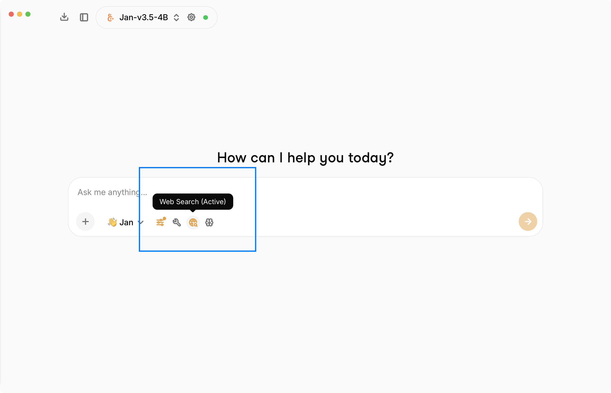
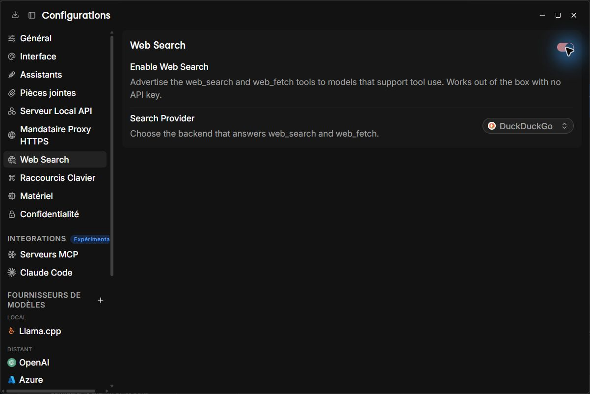

import { Callout } from 'nextra/components'

# Web Search

Jan has **built-in web search**. When enabled, Jan advertises two tools - `web_search` and
`web_fetch` - to any model that supports tool use, so the model can look up current information and
read web pages on its own. The default DuckDuckGo provider needs **no API key** and **no manual MCP setup**.

<Callout type="info">
Web Search is **on by default**. New configurations select **DuckDuckGo**. Jan starts its search
server on the first search or page read; the first use may take longer while Jan downloads the
server package. An internet connection is required. Existing saved provider choices and disabled
web-search preferences are preserved.
</Callout>

You can toggle web search for a chat from the input toolbar - the globe icon shows **Web Search (Active)** when it's on.

DuckDuckGo is managed only from **Settings > Web Search**. Its internal server and raw tools
are hidden from MCP Servers and the general tool picker, so there is only one search control.
Turning Web Search off prevents the internal tools from being offered through MCP routing.

## The two tools

| Tool | What it does |
|------|--------------|
| **`web_search`** | Searches the web and returns a ranked list of results (title, URL, snippet, and optional publish date). |
| **`web_fetch`** | Fetches a web page by URL and returns its readable text content, along with the source URL and title. |

A typical flow is `web_search` to find sources, then `web_fetch` to read a specific result in full.
`web_search` takes a `query` and an optional `count` (default 5, max 20); `web_fetch` takes an
http(s) `url`. Fetched content is length-bounded so it doesn't flood the model's context: a page is
cut to a fraction of the model's context window, and never past **Max tool output characters** in
**Settings > MCP Servers** (40,000 by default). With that setting at `0` only the fetch's own
40,000-character bound applies. A page that was cut ends with `[content truncated]`.

## Requirements

Web search only works with a model that supports **tool use**. The tools are advertised only to
tools-capable models, so pick a model that shows the **tools** capability in the model picker (most
local tool-calling models and the major cloud models qualify). If your model can't call tools, the
web tools won't be available.

## Configure it

Open **Settings > Web Search**.

### Enable Web Search

Toggles whether the `web_search` and `web_fetch` tools are advertised to models that support tool
use. On by default. Works with no API key.

### Search Provider

Choose the backend that answers `web_search` and `web_fetch`. Five providers are available:

| Provider | API key | Notes |
|----------|---------|-------|
| **DuckDuckGo** (default) | None | Jan manages the search server automatically. Search results appear as source citations; pages are returned as readable text. |
| **Exa** | Optional | Uses a free, keyless endpoint out of the box. Add a key for higher rate limits and structured results. |
| **Tavily** | Required | Needs a [Tavily](https://tavily.com) API key to return results. |
| **SearXNG** | Optional | Self-hosted. Point Jan at your own [SearXNG](https://searxng.org) instance URL (with the JSON API enabled). |
| **You.com** | Optional | Keyless search works out of the box, subject to a daily request cap. A [You.com](https://you.com/platform) API key lifts the cap and gives `web_fetch` extracted page content instead of raw HTML. |

### Exa API Key (optional)

With Exa selected, an API key is **optional** - leave it empty to use the free keyless endpoint.
Providing an [Exa](https://exa.ai) API key gives you higher rate limits and structured results.

<Callout type="info">
For **Tavily**, an API key is required. For **SearXNG**, you provide your instance's base URL instead
of a key. The settings panel shows the right field for whichever provider you pick.
</Callout>

## How it relates to MCP search

DuckDuckGo uses the [DuckDuckGo MCP server](https://github.com/nickclyde/duckduckgo-mcp-server)
through Jan's existing [MCP integration](/docs/desktop/mcp). Jan includes a preset pinned to version
`0.7.0`, with the browser backend available for search and page reading. Opening Jan does not start
this inactive preset; selecting DuckDuckGo and using a web tool starts it when needed.

If you already have a server named **DuckDuckGo**, Jan reuses its connection and configuration,
including its region and other environment settings. Otherwise Jan uses the built-in preset.
You can disable Web Search or choose another provider in **Settings > Web Search**. Exa, Tavily,
SearXNG and You.com continue to use the native web-search plugin. These defaults apply to the
desktop tools; native plugin and CLI provider defaults are unchanged.
